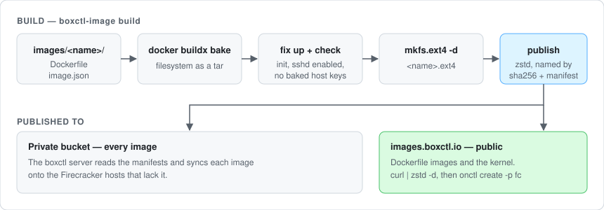

# boxctl-images

The images a [boxctl](https://boxctl.io) box boots, and `boxctl-image`,
the tool that builds and publishes them.

## Download

Each image is a zstd-compressed ext4 root filesystem for Firecracker.
Anyone can download these:

| Image | What it is | Download |
|---|---|---|
| `alpine` | Alpine with OpenRC and sshd; the smallest, for trying a setup | [9 MB](https://images.boxctl.io/images/latest/alpine.ext4.zst) |
| `debian-slim` | Minimal Debian 13, SSH only | [60 MB](https://images.boxctl.io/images/latest/debian-slim.ext4.zst) |
| `ubuntu-26.04` | Minimal Ubuntu 26.04, SSH only | [83 MB](https://images.boxctl.io/images/latest/ubuntu-26.04.ext4.zst) |
| `openai-agents` | Debian Slim plus Node.js and the Codex CLI | [438 MB](https://images.boxctl.io/images/latest/openai-agents.ext4.zst) |
| `claude-agent` | Debian Slim plus git, gh and Claude Code | [510 MB](https://images.boxctl.io/images/latest/claude-agent.ext4.zst) |
| `claude-agent-go` | `claude-agent` plus Go and gcc | [656 MB](https://images.boxctl.io/images/latest/claude-agent-go.ext4.zst) |
| `boxctl-kernel` | The guest kernel every image boots with | [11 MB](https://images.boxctl.io/kernel/latest/boxctl-kernel.vmlinux.zst) |

Sizes are the download; a rootfs unpacks to 4 GiB (`alpine` to 512 MiB),
mostly empty. To boot one with [onctl](https://github.com/cdalar/onctl)
on a Linux host with KVM and Firecracker:

```bash
curl -fsSL https://images.boxctl.io/images/latest/alpine.ext4.zst | zstd -d -o alpine.ext4
curl -fsSL https://images.boxctl.io/kernel/latest/boxctl-kernel.vmlinux.zst | zstd -d -o vmlinux
sudo onctl create -n box -p fc --rootfs-image $PWD/alpine.ext4 --kernel-image $PWD/vmlinux
```

`https://images.boxctl.io/catalog/<name>.json` is an image's manifest: the
sha256 a download must unpack to, its size, and earlier builds.
`claude-agent` and `claude-agent-go` are also container images, at
`ghcr.io/boxctl-io/claude-agent` and `ghcr.io/boxctl-io/claude-agent-go`.

## How an image is built



An image is a directory, `images/<name>/`, holding a `Dockerfile` and an
`image.json` (label, description, size, status). `boxctl-image build
<name>` then:

1. Runs `docker buildx bake` and exports the filesystem as a tar.
2. Unpacks it and fixes what Docker manages during a build (`/etc/hosts`,
   `/etc/hostname`, `/etc/resolv.conf`, `/etc/machine-id`).
3. Checks it will boot as a box: an init (systemd, or busybox with
   OpenRC), sshd enabled, no SSH host keys baked in.
4. Makes the ext4 from the directory with `mkfs.ext4 -d`.

On a push to `main` that changes an image, CI builds it and `boxctl-image
publish` uploads it, named by its sha256, with its manifest: to the
bucket boxctl's own hosts sync from, and to `images.boxctl.io`.

To add an image, add `images/<name>/image.json` and
`images/<name>/Dockerfile` (`FROM` a pinned Debian or Ubuntu base, then
`RUN --mount=from=common,target=/boxctl sh /boxctl/install.sh`) and open
a pull request.

Everything else -- image statuses, converting a container image, the
kernel, the images built by bake scripts, CI and its secrets -- is in
[docs/reference.md](docs/reference.md); the designs are in
[docs/plans](docs/plans).
